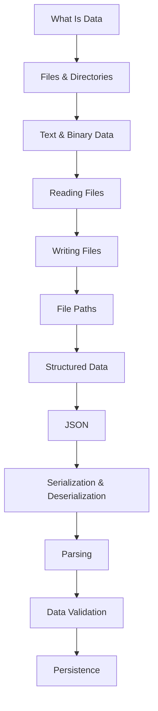

# 03 - Files & Data

*`00-foundations/03-files-and-data/`, part of [Unslop](https://github.com/sage9705/unslop): don't be a vibe coder forever.*

## Overview

This section teaches your programs to remember.

Everything you built in `01-programming` forgot itself the moment it finished running. The one exception was a small `catalog.txt` that `shop-inventory-tracker` saved, and even that was a fragile format held together by comma splitting. Here you learn to read files, write them, store structured data properly, check that data before trusting it, and keep it safe between runs.

Every example builds on the shop you already know. The catalog, the sales log, deliveries, and customers all become real files with real problems.

---

## Why This Matters

Almost every program that matters has to remember something. A web server forgets every request the moment it finishes, so what a business actually runs on is the data sitting behind it. Databases, which come later in Unslop, exist to solve the problems you'll meet here first, at small scale: data that has to survive a restart, arrive in a messy format, and stay correct even when something fails halfway through.

Learning those problems with a plain file in front of you means a database, when it arrives, is an answer to questions you already understand.

---

## What You'll Learn

| Area | Topics |
|---|---|
| **Files** | what data is, files and directories, text and binary data, reading files, writing files, file paths from inside a program |
| **Structured Data** | structured data, JSON, serialization and deserialization |
| **Trustworthy Data** | parsing, data validation, persistence |

---

## Learning Path

Each concept builds on the one before it. Reading comes before writing, JSON comes before serialization, and validation only makes sense once you've parsed something worth validating.

---

## Where This Fits

`03-files-and-data/` follows `02-terminal/` inside `00-foundations/`. It draws on both earlier sections. From `01-programming`, it assumes functions, dictionaries, and exception handling. From `02-terminal`, it assumes you understand paths, can run a program from any directory, and know what redirection does.

---

## How to Learn

For each concept, follow the same loop:

1. **Understand** what the code does to the file on disk.
2. **Try it** on a real file, then open that file in a text editor and look at what's actually inside.
3. **Break it on purpose**: point it at a missing file, a damaged file, the wrong mode, the wrong directory.
4. **Fix it**, and notice exactly what changed.

Files fail in quiet ways. A wrong write mode raises no error, and a bad path may only fail on someone else's computer. Looking at the real file after every run builds the habit that catches those.

---

## Getting Unstuck

When a file function behaves unexpectedly, the official documentation is precise and short. The [Reading and Writing Files](https://docs.python.org/3/tutorial/inputoutput.html#reading-and-writing-files) section of the Python tutorial covers `open()` and its modes, and the [`json` module reference](https://docs.python.org/3/library/json.html) covers everything about reading and writing JSON.

The quickest check of all is to open the file in a text editor. Whatever your program wrote is sitting there, exactly as it will be read back.

---

## What You Should Be Able to Do

By the end of this section, you should be able to:

- read a text file line by line, and make sure it closes properly
- write and append to a file, choosing the right mode on purpose
- explain why a relative path inside a program can resolve to different places, and build a path that doesn't depend on where the program was launched
- store and load structured data as JSON
- explain what serialization and deserialization mean
- parse messy text into structured values
- validate data before trusting it
- keep data across runs, and explain what could go wrong if a write is interrupted

---

## How This Folder Is Organized

| Folder | What It's For |
|---|---|
| `concepts/` | the mental models and the syntax, from what data is through to persistence |
| `examples/` | four complete, working programs built on the shop catalog |
| `exercises/` | six practice problems with starter code and a `self_check()` |
| `debugging/` | broken programs reported as symptoms, to investigate and fix |
| `checkpoint.md` | a self check, with a new task and a script that verifies it |

There's no separate `tools/` folder here. The syntax this section needs is small, `open()`, `with`, and the `json` module, so it lives right inside the concepts that use it.

---

## The Real Goal

The most important thing you're learning here goes beyond file functions:

> Can you trust the data your program reads, and can you trust the data it writes?

Every backend system answers that question constantly. Data arrives from files, forms, and other systems, and it arrives malformed, missing, or wrong. Data going out has to survive crashes, restarts, and mistakes. Habits like checking before trusting, and protecting what's already there before replacing it, carry straight into databases, APIs, and every system that follows.

---

## Completion

You're ready to move on once you can take a messy file, turn it into data your program can trust, store it so it survives a restart, and recover sensibly when the file is missing or damaged.

**Next:** `00-foundations/04-git/`, where the history of your own work gets the same protection your data just received.
