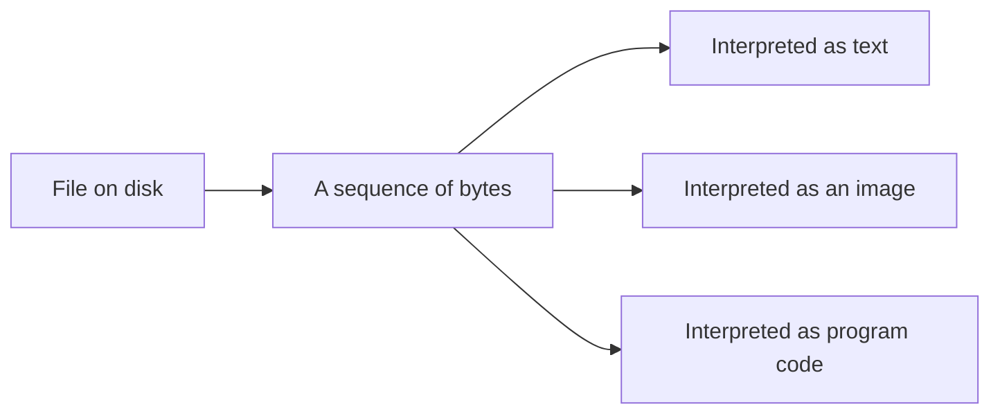

# Files and Directories, Revisited

*`00-foundations/03-files-and-data/concepts/02-files-and-directories.md`, part of [Unslop](https://github.com/sage9705/unslop)*

> **Fundamental**

## The Question

From a program's point of view, what actually is a file?

---

## A Shift in Focus

`02-terminal/concepts/03-files-and-directories.md` covered files and directories as locations, things you navigate to with `cd`, list with `ls`, find with `find`. That's the address side of a file.

This folder cares about something else: what's actually inside one, and how a program reads or changes that content. Underneath, a file is just a sequence of bytes sitting on disk, with a name and a location. Whether those bytes represent plain text, a JSON config, a photo, or a sound clip, the filesystem itself has no idea, and doesn't care. Interpreting those bytes is entirely up to whatever program opens the file.

---

## The Extension Is a Hint, Not a Rule

`.txt`, `.py`, `.json`, `.md`, these extensions are a convention, a signal to humans and to programs about how the content is meant to be read. Nothing enforces it. A plain text file renamed `data.py` would still just contain text, Python would try to run it as code and almost certainly fail, but the bytes inside never changed, only the expectation attached to the name did.

`catalog.txt`, `main.py`, and `README.md` are all, underneath, the exact same kind of thing: bytes on disk. What makes one data, one code, and one documentation is purely how it gets interpreted, by a program or by a person, not anything inherent in the file itself.

---

## Where This Shows Up

Every file format decision in real software comes down to this. A web server deciding whether to treat an uploaded file as an image or reject it isn't reading the file's extension and trusting it blindly, a careful one actually inspects the bytes themselves, because a file's name is just a label, and labels can lie, by mistake or on purpose.

---

## Try It

Open `catalog.txt` from `shop-inventory-tracker` in a plain text editor, and then open a `.py` file from the same folder. Both are plain text underneath, readable by the same kind of tool, even though one is "data" and the other is "code" by convention and purpose, not by anything different about how the bytes are stored.

---

## What You Need to Understand

- a file is a sequence of bytes, a name, and a location
- a file's extension is a convention, not an enforced rule
- interpreting a file's content is the job of the program opening it, not the filesystem

---

## Exercise

Pick three files from `01-programming`, one `.py`, one `.md`, one `.txt` if you have one. Open each in a plain text editor and confirm all three are readable as text, despite serving completely different purposes.

---

## Checkpoint

Explain, in your own words:

1. What is a file, underneath its name and extension?
2. Why doesn't a file's extension guarantee what kind of content it actually holds?
3. What's the difference between a file's location and a file's content?
