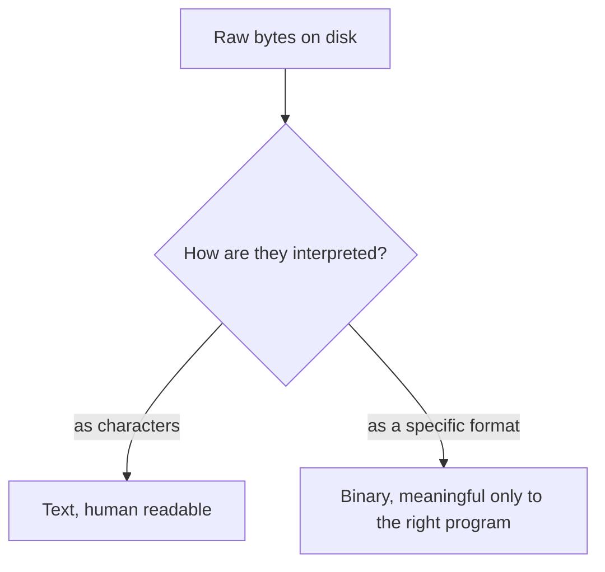

# Text and Binary Data

*`00-foundations/03-files-and-data/concepts/03-text-and-binary-data.md`, part of [Unslop](https://github.com/sage9705/unslop)*

> **Understand**

## The Question

Why does it matter whether a file gets treated as text or as binary?

---

## Two Ways to Read the Same Bytes

**Text data** is bytes interpreted as characters, according to an encoding, UTF-8 being the overwhelmingly common one today. Open a text file directly, and a human can read it. `catalog.txt`, every `.py` file, every `.md` file in `01-programming`, all of it is text.

**Binary data** is bytes meant to be interpreted by a specific program or format, not read directly as characters. A compiled `.pyc` file, the kind that showed up in `__pycache__` during `02-terminal/debugging/`, is binary. So is an image, a zipped archive, an audio file. Open one directly in a text editor, and it looks like garbled nonsense, because it was never meant to be read that way.

---

## Why the Distinction Matters Practically

Python's `open()` needs to be told which mode to use, `"r"` for reading text, `"rb"` for reading binary. Open a binary file in text mode, and Python tries to decode bytes that were never meant to be characters, which either raises a decoding error outright or, worse, silently produces garbage. The full syntax for this comes in the next two docs, the concept to hold onto here is simpler: text and binary aren't just a style choice, they're two genuinely different ways of interpreting the exact same bytes.

---

## Where This Shows Up

`catalog.txt` is plain text by deliberate choice, anyone can open it directly and sanity check what's inside with their own eyes. A more demanding system might choose a binary format instead, for speed or compactness, trading away that easy human readability for something else. That tradeoff, readability versus efficiency, shows up constantly once real databases and file formats enter the picture later in Unslop.

---

## Try It

Open a `.pyc` file from a `__pycache__` folder, if one still exists from earlier work, in a plain text editor. Compare what you see to opening `catalog.txt` the same way. One is readable. One very much isn't, even though both are, underneath, just bytes on disk.

---

## What You Need to Understand

- text data is bytes interpreted as characters, binary data is bytes interpreted by a specific format
- opening a file in the wrong mode can cause errors or corrupted results
- the choice between text and binary is a real tradeoff, not an arbitrary one

---

## Exercise

List three files you've worked with so far across Unslop that are text, and name one real file type, even one you've never personally opened, that you'd expect to be binary. Explain your reasoning for each.

---

## Checkpoint

Explain, in your own words:

1. What's the difference between text data and binary data?
2. What happens if a binary file gets opened in text mode?
3. Why might a real system deliberately choose a binary format over plain text?
