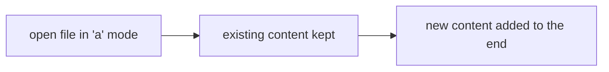

# Writing Files

*`00-foundations/03-files-and-data/concepts/05-writing-files.md`, part of [Unslop](https://github.com/sage9705/unslop)*

> **Fundamental**

## The Question

How does a program save new data to disk?

---

## Two Modes, Two Very Different Outcomes

```python
with open("catalog.txt", "w") as file:
    file.write("Rice bag,25.50,40\n")
```

`"w"` mode opens a file for writing. If the file already exists, everything it previously contained is gone the instant you open it this way, replaced entirely by whatever you write next. This is exactly how `save_catalog` works:

```python
def save_catalog(catalog, filepath):
    with open(filepath, "w") as file:
        for item_name, details in catalog.items():
            file.write(f"{item_name},{details['price']},{details['quantity']}\n")
```

`"a"` mode appends instead, adding new content onto the end of whatever already exists, without touching what was there before. This is the Python-level version of the `>>` operator covered in `02-terminal/concepts/09-pipes-and-redirection.md`, same idea, just inside a program instead of at the shell.




---

## The Real Risk

Opening a file in `"w"` mode when you meant `"a"` is one of the most common, and most avoidable, ways real data gets destroyed. The shop's `shop-inventory-tracker` deliberately uses `"w"` for `save_catalog`, every run's save is meant to fully replace the previous one, which is the right call for a catalog representing current stock. A sales log, by contrast, almost certainly wants `"a"`, each day's sales should add to the record, not erase what came before. Choosing the wrong one doesn't throw an error. It just quietly deletes something you wanted to keep.

---

## Where This Shows Up

This exact distinction decides whether a real system's log file grows over time or gets wiped every time the program restarts, whether a saved game adds a new save slot or overwrites the only one that existed, whether a backup actually backs anything up. `debugging/04-data-loss/` later in this folder walks through exactly this mistake happening for real.

---

## Try It

Write a small script that opens a file in `"w"` mode and writes one line. Run it. Then run it again, changing nothing. Open the file and confirm only the second run's line survived. Now change the mode to `"a"` and run it twice more, and watch both lines accumulate.

---

## What You Need to Understand

- `"w"` mode overwrites a file's entire previous content
- `"a"` mode adds new content onto the end, preserving what was already there
- choosing the wrong mode doesn't error, it silently loses data

---

## Exercise

Write a function `log_sale(item_name, amount, filepath)` that appends one line to a sales log file every time it's called, in the form `item_name,amount`. Call it three times with different items, then read the file back and confirm all three lines are present, in order.

---

## Checkpoint

Explain, in your own words:

1. What happens to a file's existing content when you open it in `"w"` mode?
2. When would `"a"` mode be the correct choice over `"w"`?
3. Why is picking the wrong write mode especially dangerous, compared to most other kinds of mistakes?
