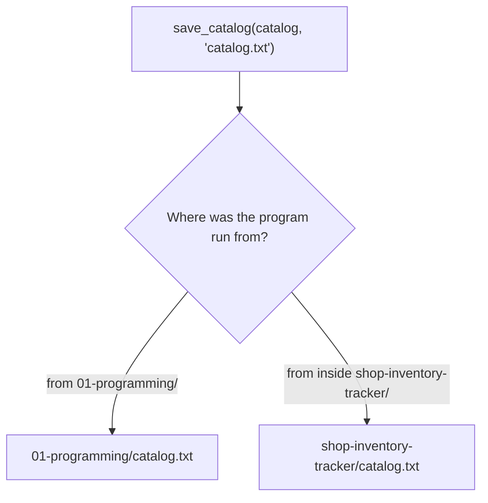

# File Paths, From Inside a Program

*`00-foundations/03-files-and-data/concepts/06-file-paths.md`, part of [Unslop](https://github.com/sage9705/unslop)*

> **Understand**

## The Question

How does a running program itself resolve a file path, and what can go wrong?

---

## A Different Angle on Something You Already Know

`02-terminal/concepts/04-paths.md` covered paths as something you type at a shell prompt. This doc covers the same idea from inside a running program, when your code itself calls `open(path)`.

A relative path used inside `open()` is resolved against the process's current working directory at the moment it runs, not against wherever the `.py` file itself happens to live on disk. Those are two different things, and confusing them is one of the most common real sources of "file not found" bugs.

```python
inventory.save_catalog(catalog, "catalog.txt")
```

This line, inside `main.py`, uses a relative path. Where `catalog.txt` actually ends up depends entirely on where the program was run from, not on where `main.py` sits in the folder tree.



This is exactly why running `shop-inventory-tracker/main.py` from `01-programming/` versus from inside its own folder produces `catalog.txt` in two completely different places, the same confusion `02-terminal/exercises/03-running-programs/` and `02-terminal/debugging/02-wrong-directory/` already walked through at the shell level. The cause is identical, just viewed from inside the code this time instead of from the terminal.

---

## A Path That Doesn't Depend on Where You Stand

Sometimes a program needs to find a file relative to its own location on disk, regardless of where it was launched from. Python's `__file__` holds the path to the currently running script, which makes this possible:

```python
import os

script_directory = os.path.dirname(os.path.abspath(__file__))
catalog_path = os.path.join(script_directory, "catalog.txt")
```

This isn't something to master deeply right now, just worth knowing it exists. A relative path depends on where you stand when you run the program. A path built from `__file__` depends on where the code itself lives, and stays correct no matter where it's launched from.

---

## Where This Shows Up

"It worked on my machine" is very often, underneath, exactly this confusion: a relative path that happened to resolve correctly because of which directory someone's terminal was sitting in at the time, and breaks the moment the same code runs somewhere else, a teammate's machine, a server, a deployment pipeline, standing in a different place.

---

## Try It

Run `shop-inventory-tracker/main.py` once from `01-programming/`, and once from inside `examples/shop-inventory-tracker/`. Use `find . -name "catalog.txt"` afterward to see exactly where each run left its file.

---

## What You Need to Understand

- a relative path inside a program resolves against the current working directory, not the script's own location
- this is why the same program can produce files in different places depending on where it's launched from
- `__file__` gives a program a way to find its own location on disk, independent of where it was run from

---

## Exercise

Predict, before running anything, where `catalog.txt` will end up if you run `python examples/shop-inventory-tracker/main.py` from `01-programming/`. Then predict where it would end up if you instead `cd`'d into `shop-inventory-tracker/` first. Run both and confirm.

---

## Checkpoint

Explain, in your own words:

1. What does a relative path inside `open()` actually resolve against?
2. Why can the exact same line of code produce a file in two different places?
3. What does `__file__` give a program access to, and why might that matter?
