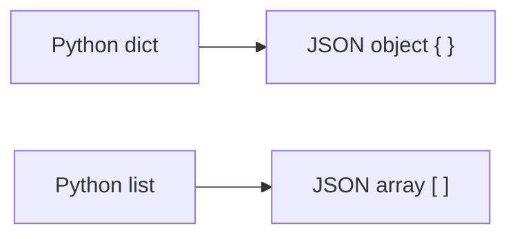

# JSON

*`00-foundations/03-files-and-data/concepts/08-json.md`, part of [Unslop](https://github.com/sage9705/unslop)*

> **Fundamental**

## The Question

What is JSON, and why does it show up absolutely everywhere in real software?

---

## The Same Shop Catalog, Differently

Here's the catalog as a Python dict:

```python
catalog = {
    "Rice bag": {"price": 25.50, "quantity": 40},
    "Sugar": {"price": 12.75, "quantity": 30},
}
```

And here's that exact same information as JSON:

```json
{
  "Rice bag": {
    "price": 25.5,
    "quantity": 40
  },
  "Sugar": {
    "price": 12.75,
    "quantity": 30
  }
}
```

Notice how closely the two match. Curly braces for an object, the JSON word for something shaped like a dict. Square brackets for an array, the JSON word for something shaped like a list. Strings in quotes, numbers bare, this isn't a coincidence, JSON's structure was deliberately built to map cleanly onto exactly the data shapes most programming languages already use.



---

## Why It Beats a Comma Split

A product name containing a comma, "Rice, 5kg bag", is completely safe in JSON, because strings are explicitly quoted and escaped, there's no ambiguity about where one value ends and the next begins. Adding a new field to every product means adding one key, nothing else has to change. JSON also distinguishes real types, numbers, strings, booleans, `null`, rather than treating everything as plain text the way `catalog.txt` does, where `"40"` and `40` would otherwise look identical.

---

## Where This Shows Up

Nearly every API on the internet sends and receives JSON. Nearly every modern config file format either is JSON or borrows heavily from it. It's about as close to a universal data format as exists in software right now, which is exactly why it's worth learning properly here, rather than later, under pressure, mid-project.

---

## Try It

Take one product from a shop catalog and write it out by hand as JSON, exactly matching the shape shown above. Pay attention to where the quotes go, strings need them, numbers don't.

---

## What You Need to Understand

- JSON objects correspond to Python dicts, JSON arrays correspond to Python lists
- JSON distinguishes real types, unlike a plain comma-separated text file
- JSON's near universal adoption is why it's worth learning as a default, not an exception

---

## Exercise

Rewrite the entire shop catalog, at least three products, as JSON by hand, without using any tool to generate it. Then check it against the shape shown in this doc for correctness.

---

## Checkpoint

Explain, in your own words:

1. What JSON structure corresponds to a Python dict? What corresponds to a Python list?
2. Why is a product name containing a comma safe in JSON, but risky in `catalog.txt`'s format?
3. Why would an API choose to send JSON instead of plain comma-separated text?
