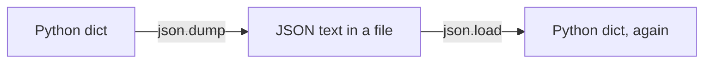

# Serialization and Deserialization

*`00-foundations/03-files-and-data/concepts/09-serialization-and-deserialization.md`, part of [Unslop](https://github.com/sage9705/unslop)*

> **Understand**

## The Question

How does a Python dictionary in memory actually become text in a file, and back again?

---

## Two Directions, One Round Trip

**Serialization** converts a live, in-memory object into a format that can be stored or sent somewhere, text, in this case. **Deserialization** reverses it, reading that stored format back into a live object your program can actually use again.

Python's `json` module gives you four functions, in two matched pairs:

| Function | Direction | Works With |
|---|---|---|
| `json.dumps(obj)` | serialize | returns a JSON string |
| `json.dump(obj, file)` | serialize | writes JSON directly to an open file |
| `json.loads(text)` | deserialize | parses a JSON string into a Python object |
| `json.load(file)` | deserialize | reads JSON directly from an open file |

```python
import json

catalog = {"Rice bag": {"price": 25.50, "quantity": 40}}

with open("catalog.json", "w") as file:
    json.dump(catalog, file, indent=2)

with open("catalog.json", "r") as file:
    loaded_catalog = json.load(file)

print(loaded_catalog == catalog)   # True
```



---

## Compare This to What You Already Built

`inventory.py`'s `save_catalog` and `load_catalog`, from `01-programming`, were a hand-rolled version of exactly this round trip, built manually with string splitting and formatting because JSON hadn't been introduced yet. `json.dump` and `json.load` do the same job, far more robustly, handling quoting, escaping, and type conversion automatically instead of relying on a fragile comma split.

---

## Where This Shows Up

Every time a program calls a real API and gets a response back, every time an application saves its own state to reload later, this exact round trip is happening, serialize going out, deserialize coming back. It's one of the most common operations in all of backend development, covered in depth once Unslop reaches that phase.

---

## Try It

Take a Python dict representing one shop product. Serialize it with `json.dumps`, print the result, and look at it as plain text. Then deserialize that exact string back with `json.loads`, and confirm the result equals what you started with.

---

## What You Need to Understand

- serialization turns a live object into storable text, deserialization reverses it
- `json.dumps`/`json.loads` work with strings, `json.dump`/`json.load` work directly with open files
- this round trip is how `save_catalog` and `load_catalog` could be rewritten more reliably

---

## Exercise

Rewrite `save_catalog` and `load_catalog` from `shop-inventory-tracker` to use `json.dump` and `json.load` instead of manual string splitting. Confirm a catalog saved with your new version loads back identical to how it started.

---

## Checkpoint

Explain, in your own words:

1. What's the difference between serialization and deserialization?
2. What's the difference between `json.dumps` and `json.dump`?
3. Why is `json.dump`/`json.load` more reliable than the hand-rolled version in `inventory.py`?
