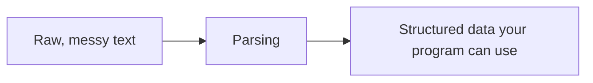

# Parsing

*`00-foundations/03-files-and-data/concepts/10-parsing.md`, part of [Unslop](https://github.com/sage9705/unslop)*

> **Understand**

## The Question

What do you do when the data arriving isn't already in a convenient format like JSON?

---

## A Skill You Already Have a Name For

**Parsing** means taking raw text and extracting meaningful, structured data out of it. You already did this, by hand, in `01-programming/exercises/05-data-processing/`, splitting a messy sales log line into item name, price, and quantity:

```python
def parse_log_line(raw_line):
    parts = raw_line.split(",")
    item_name = parts[0].strip().title()
    price = float(parts[1].strip())
    quantity = int(parts[2].strip())
    return item_name, price, quantity
```

That's a parser. A small, specific, hand-built one, but a real parser all the same. This doc just names the skill explicitly.

---

## JSON Parsing Is a Special Case

`json.loads` is also a parser, just one someone else already wrote, thoroughly tested, and gave away for free as part of Python's standard library. Most real data doesn't arrive with that luxury. A spreadsheet export, a scraped web page, a log file from some other system, a user's typed input, none of it necessarily follows a format with a ready-made parser waiting.



---

## Hand Rolled Parsing Has Limits

Splitting on commas works fine for simple, well understood formats, right up until the data stops behaving, a comma inside a quoted field, an extra space in an unexpected place, a line that's missing a column entirely. This is exactly why standard formats like JSON, with a parser already built and battle tested, are worth reaching for whenever you control the format being used. Hand rolled parsing stays necessary for everything else, the formats you don't get to choose.

---

## Where This Shows Up

Integrating with almost any external data source, a bank statement export, a government open data file, a competitor's product listings scraped from a webpage, nearly always starts with writing or adapting a parser, because the data rarely arrives already shaped the way your program needs it.

---

## Try It

Look back at `parse_log_line` from `01-programming`. Identify each individual step it takes to turn one raw string into three separate, usable values. That sequence, split, strip, convert, is the shape most simple parsers take.

---

## What You Need to Understand

- parsing means extracting structured data from raw, unstructured text
- `json.loads` is a parser too, just one that's already written for you
- hand rolled parsing is fragile around edge cases, but often unavoidable for formats you don't control

---

## Exercise

Write a parser for a new raw format: lines shaped like `"Product: Rice bag | Price: 25.50 | Qty: 40"`. Extract the product name, price, and quantity from a handful of lines in this format, handling the `|` separators and the labels in front of each value.

---

## Checkpoint

Explain, in your own words:

1. What does it mean to parse a piece of raw text?
2. Why is `json.loads` considered a parser, even though you never had to write it?
3. What kind of real-world data would force you to write your own parser, rather than relying on an existing one?
