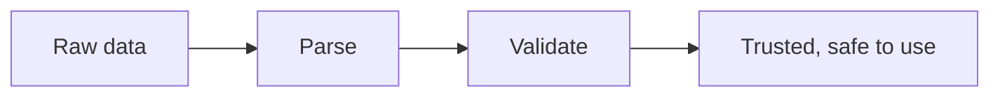

# Data Validation

*`00-foundations/03-files-and-data/concepts/11-data-validation.md`, part of [Unslop](https://github.com/sage9705/unslop)*

> **Fundamental**

## The Question

Just because data parses successfully, does that mean it's actually safe to use?

---

## Two Separate Questions

Parsing answers one question: can this text be understood as structured data at all? Validation answers a completely different one: does this data actually make sense, and is it safe to act on?

A quantity of `-5` parses perfectly fine as an integer. A price of `"free"` parses perfectly fine as a string. A product record missing its price entirely still parses, it just has one less key than expected. None of that is a parsing failure. All of it is nonsense a shop shouldn't act on without a second check.

---

## You've Already Done This

`13-errors-and-exceptions.md`, back in `01-programming`, and the Supplier Order Manager exercise both already practiced validation, just without naming it yet. Raising `ValueError` for a non-positive order quantity wasn't a parsing concern, the text `"-5"` parses into the integer `-5` without any trouble. It was a validation concern, the number is real, and still not acceptable.

Common checks worth building a habit around:

- is the type correct, a number where a number is expected, not text pretending to be one
- is the value within a sensible range, a quantity above zero, a price that isn't negative
- is a required field actually present, rather than silently missing
- does a value match an expected shape, a product code following the right pattern

---

## Where This Shows Up

Validating data at the exact moment it enters your system, from a file, a form, an API, a command line argument, is one of the most important habits in real software. A striking share of production data corruption bugs, and a fair share of real security vulnerabilities, trace back to data that was trusted without ever being checked. Parsing tells you the shape is readable. Validation is what actually decides whether to trust it.

---

## Try It

Take a parsed product record, `{"name": "Rice bag", "price": -5, "quantity": "forty"}`. It parses without any error at all. List every individual thing wrong with it that a human would catch immediately but a parser never would.

---

## What You Need to Understand

- parsing confirms data is structurally readable, validation confirms it's actually sensible
- a value can parse perfectly and still be wrong, missing, or dangerous to use
- validating data at the boundary, right where it enters your system, is a core habit in real software

---

## Exercise

Write a function `validate_product(product)` that takes a dict like `{"name": ..., "price": ..., "quantity": ...}` and returns `True` only if `name` is a non-empty string, `price` is a positive number, and `quantity` is a non-negative integer. Test it against both a valid product and the broken one shown above.

---

## Checkpoint

Explain, in your own words:

1. What's the difference between data that parses successfully and data that's actually valid?
2. Give one example of a value that would parse fine but fail validation.
3. Why does validating data right as it enters a system matter more than validating it later?
