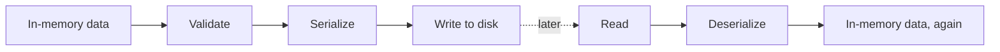

# Persistence

*`00-foundations/03-files-and-data/concepts/12-persistence.md`, part of [Unslop](https://github.com/sage9705/unslop)*

> **Understand**

## The Question

How do you make sure a program's data actually survives, reliably, being closed, restarted, or interrupted?

---

## Bringing the Whole Folder Together

`01-what-is-data.md` opened this folder by asking why data needs to outlive a single run at all. Everything since has been building toward answering that properly:

Reading and writing, from `04` and `05`, are the mechanism. JSON and serialization, from `08` and `09`, are the format. Validation, from `11`, protects what goes in. **Persistence** is the whole goal these pieces exist to serve, data that reliably survives.

---

## A Risk Worth Knowing About Now

Writing isn't instantaneous. If a program crashes, loses power, or gets killed mid-write, a file can end up half written, truncated partway through, technically present but genuinely corrupted. `shop-inventory-tracker`'s `save_catalog`, interrupted at exactly the wrong moment, could leave `catalog.txt` with a cut off final line, something the shop would only discover the next time the program tried, and failed, to read it back.

This isn't something to solve deeply right now, just worth knowing it's a real risk. Safer patterns exist, like writing to a temporary file first and only replacing the real one once the write finishes completely, but mastering that belongs later, once the basic read and write patterns in this folder feel automatic.

---

## Where This Shows Up

This exact risk, a write interrupted partway through, is a large part of why real databases exist at all. They're built specifically to make persistence reliable even when something goes wrong mid-operation, a guarantee hand rolled file writing doesn't give you for free. `debugging/04-data-loss/`, later in this folder, walks through exactly this kind of failure directly.

---

## Try It

Think back through every file written across `01-programming` and `02-terminal`, `catalog.txt`, log files, audit reports. For one of them, imagine the program crashed exactly halfway through writing it. Picture what the file would actually look like afterward.

---

## What You Need to Understand

- persistence is the overall goal this whole folder has been building toward
- a write interrupted midway can leave a file corrupted, not just incomplete
- safer writing patterns exist, worth knowing about even before mastering them

---

## Exercise

Look at `save_catalog` one more time. Write a sentence describing exactly what `catalog.txt` would contain if the program were interrupted after writing two of its five products. Then write a second sentence describing how a shop owner would actually discover that problem.

---

## Checkpoint

Explain, in your own words:

1. What ties together reading, writing, JSON, and validation into one overall goal?
2. What can happen to a file if a write gets interrupted partway through?
3. Why do real databases exist, in terms of what this doc just covered?

This closes out `concepts/`. `examples/` next puts every piece of this folder together in working programs.
